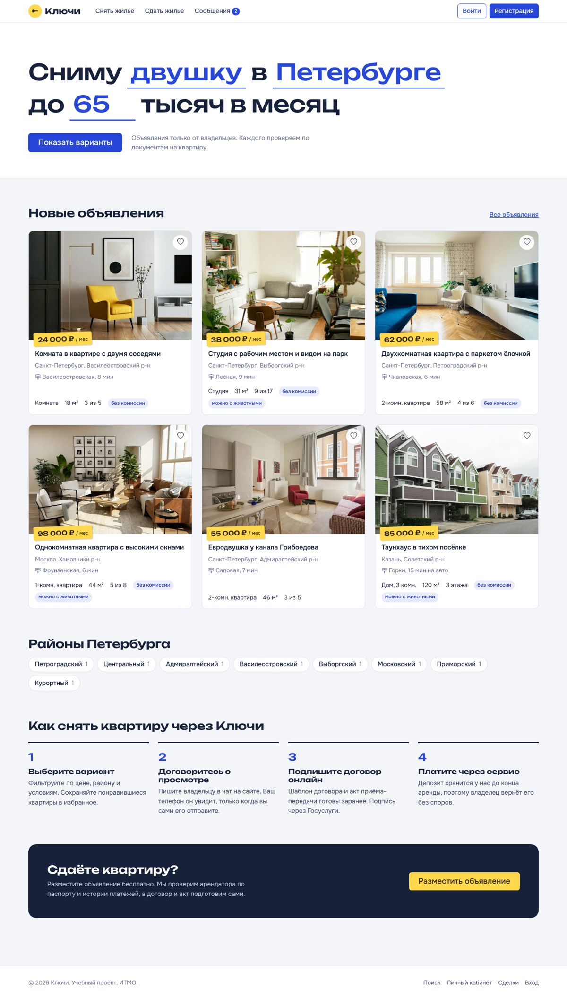
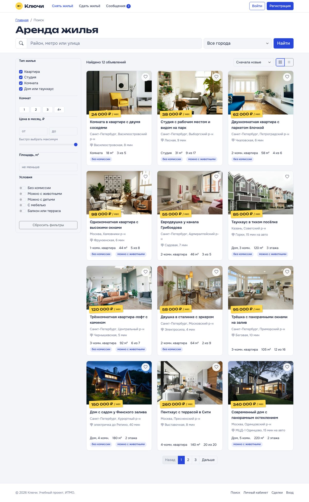
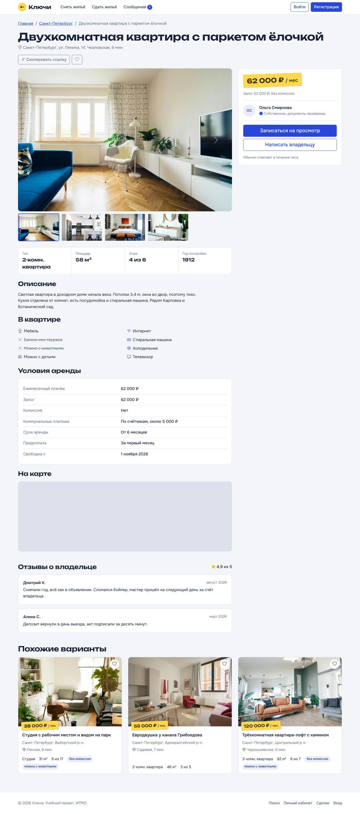
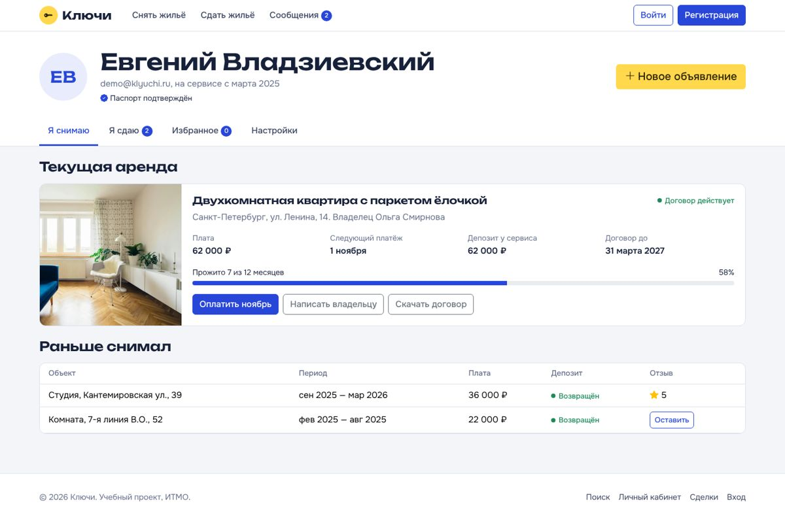
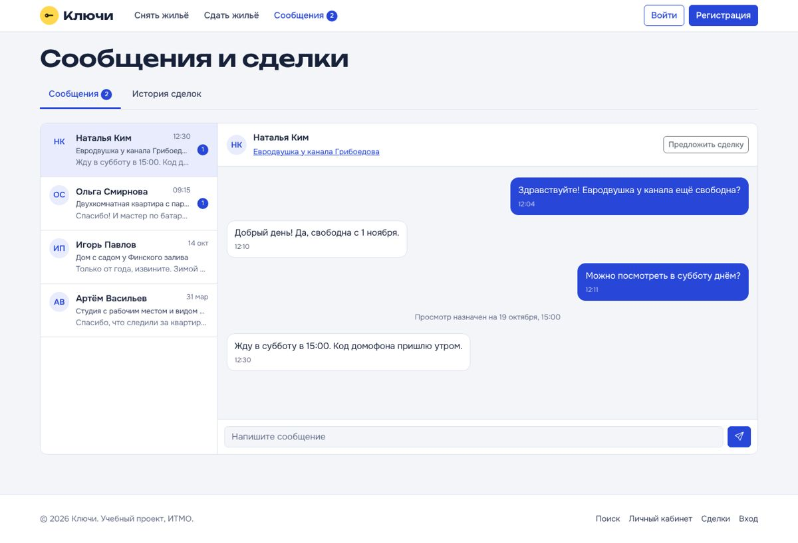
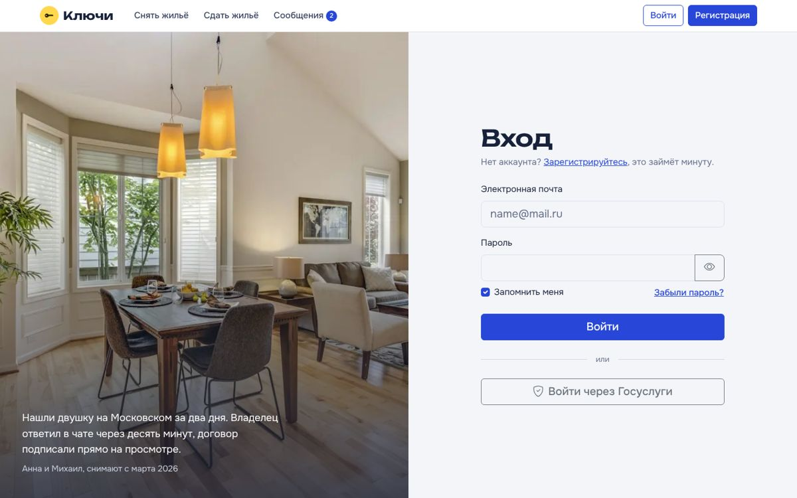
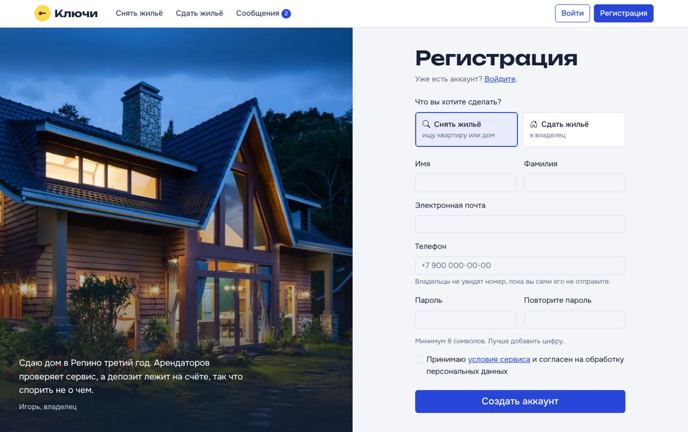
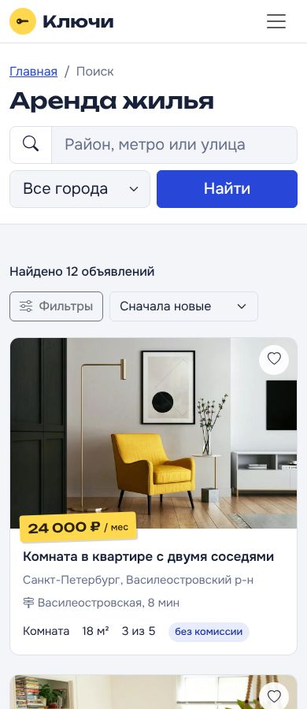
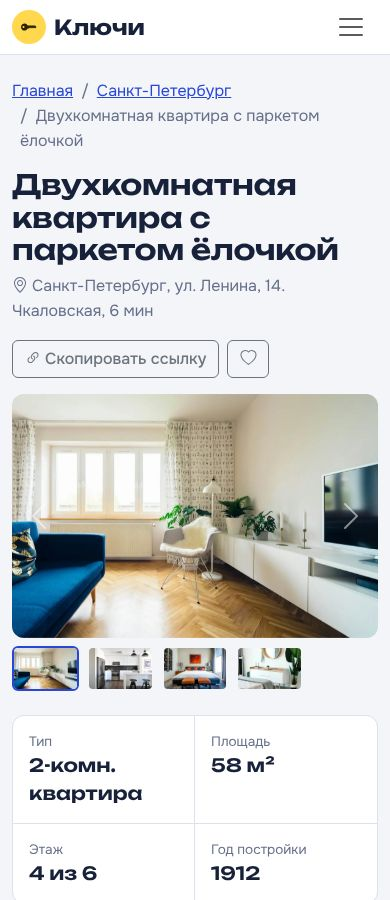

# Лабораторная работа 1. Вёрстка сайта средствами HTML, CSS и Bootstrap

Студент: Владзиевский Евгений, группа K3441

Вариант 4: сервис для аренды недвижимости «Ключи».

## Что сделано

Сайт сверстан на Bootstrap 5.3 с собственной темой поверх него (`css/style.css`). Шрифты Unbounded для заголовков и цен и Onest для текста, оба с кириллицей. Иконки из Bootstrap Icons.

| Страница | Файл | Что есть |
|---|---|---|
| Главная | `index.html` | Поиск в виде фразы «Сниму двушку в Петербурге до 65 тысяч в месяц», свежие объявления, районы, шаги аренды |
| Вход | `login.html` | Валидация, показ пароля, модальное окно восстановления пароля |
| Регистрация | `register.html` | Выбор роли (снимаю или сдаю), проверка телефона и совпадения паролей, модалка с условиями |
| Личный кабинет | `profile.html` | Вкладки «Я снимаю» (текущая и прошлые аренды), «Я сдаю» (мои объекты и заявки на просмотр), «Избранное», «Настройки». Модалки нового объявления и оплаты |
| Поиск | `search.html` | Фильтры по типу, комнатам, цене, площади, городу, району и условиям. Сортировка, вид плиткой или списком. На телефоне фильтры уезжают в offcanvas |
| Объект | `property.html?id=1` | Галерея-карусель, параметры, удобства, условия аренды, карта OpenStreetMap, отзывы, модалки записи на просмотр и сообщения владельцу |
| Сообщения и сделки | `messages.html` | Чат с владельцами и история сделок с фильтром по статусу |

## Где используется JS

- фильтрация и сортировка объявлений на странице поиска (`js/search.js`), параметры с главной передаются через URL;
- вход и регистрация с проверкой форм, пользователь сохраняется в `localStorage` (`js/auth.js`);
- избранное на сердечках карточек, тоже в `localStorage` (`js/main.js`);
- страница объекта собирается из данных по `id` (`js/property.js`);
- отправка сообщений в чат и фильтр сделок (`js/messages.js`);
- модальные окна, вкладки, выпадающие меню, тосты и карусель из Bootstrap.

Данные лежат в `js/data.js`. В ЛР2 их заменит json-server.

## Адаптивность

Сетка Bootstrap плюс свои медиазапросы. Проверено на ширине 390 px (iPhone 14) и 1440 px.

## Запуск

Открыть `index.html` в браузере или поднять локальный сервер:

```bash
python3 -m http.server 8000
```

## Скриншоты

Главная



Поиск с фильтрами



Страница объекта



Личный кабинет



Сообщения и сделки



Вход и регистрация




Мобильная версия

 

Фотографии интерьеров взяты с Unsplash (бесплатная лицензия Unsplash).
